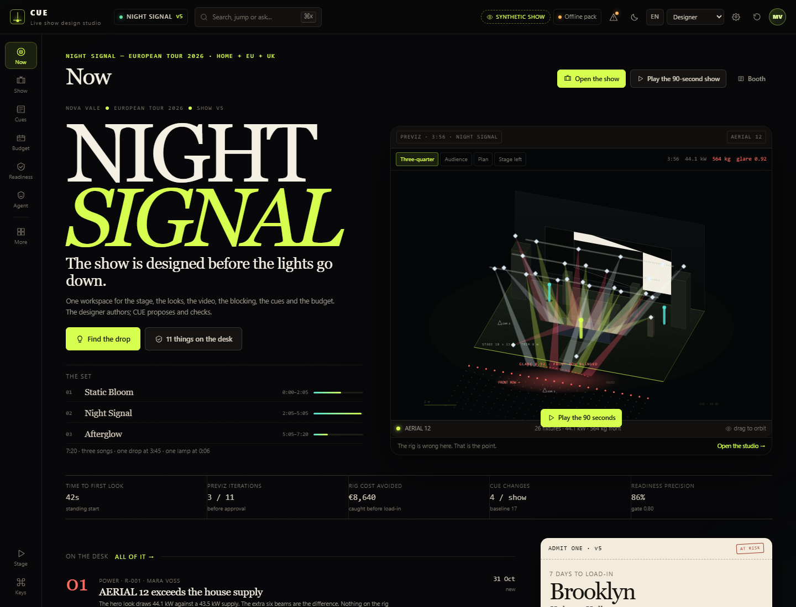
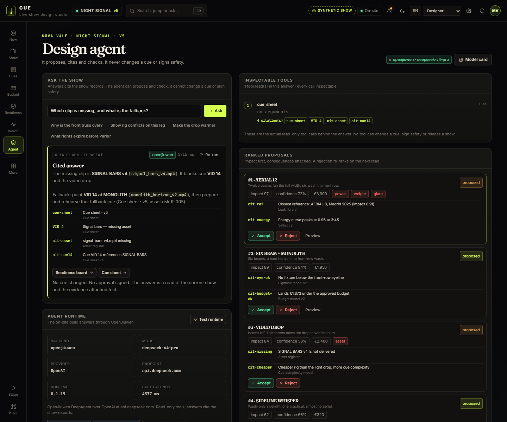
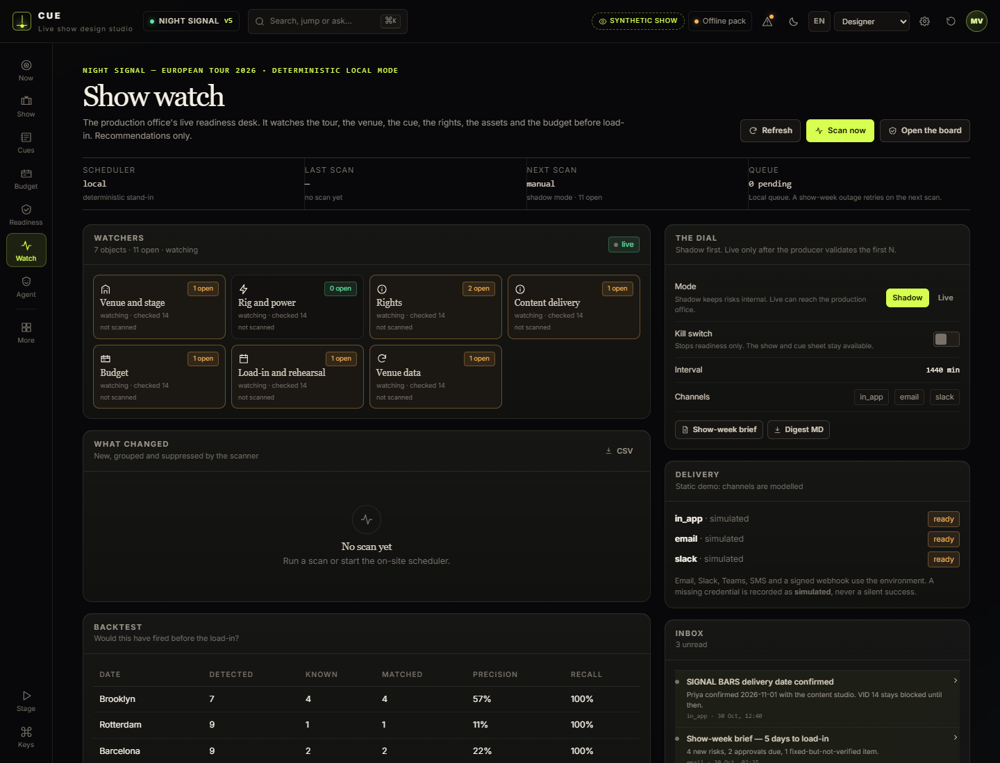
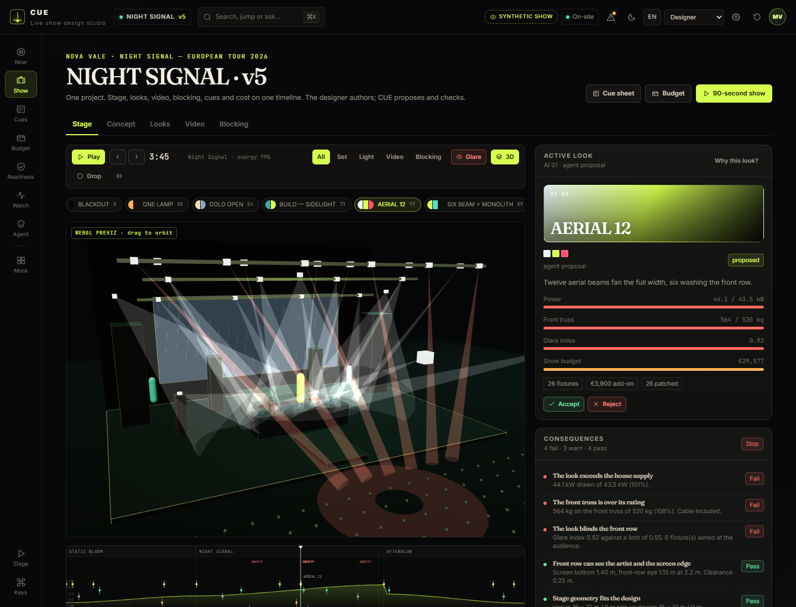
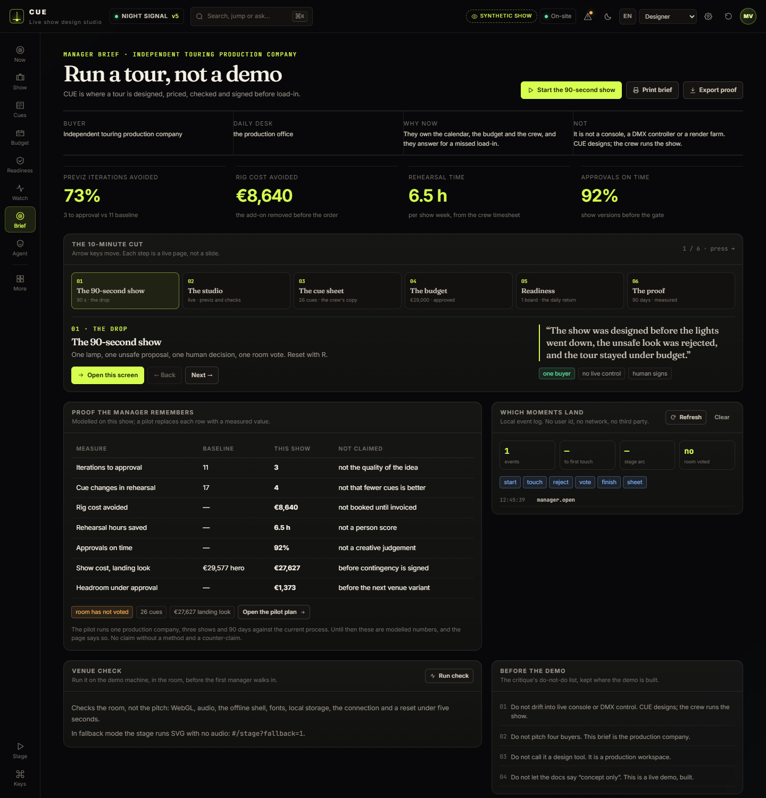
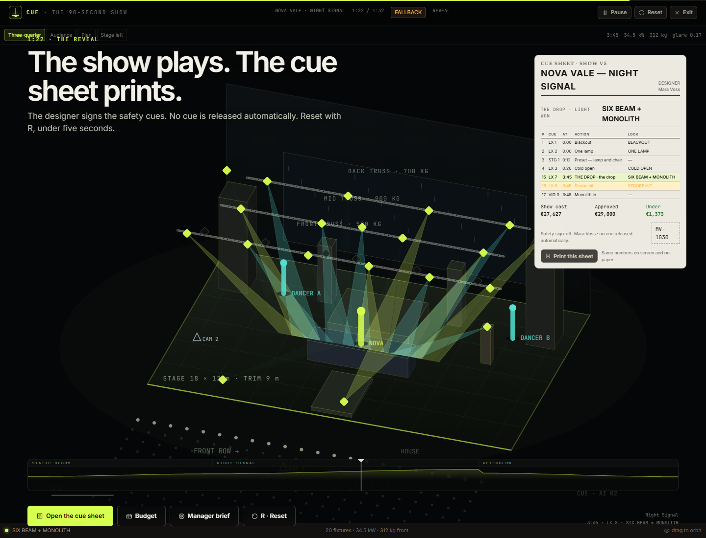
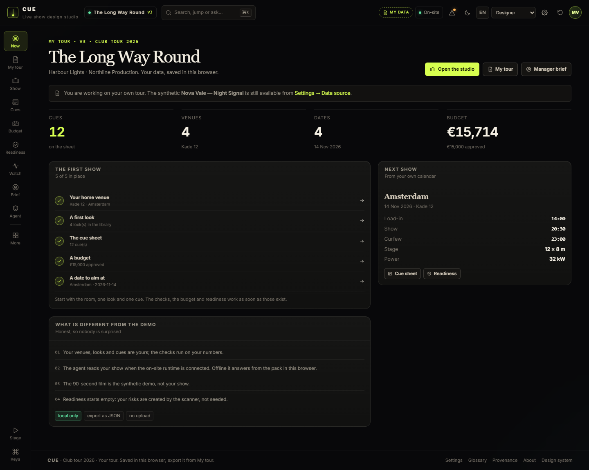
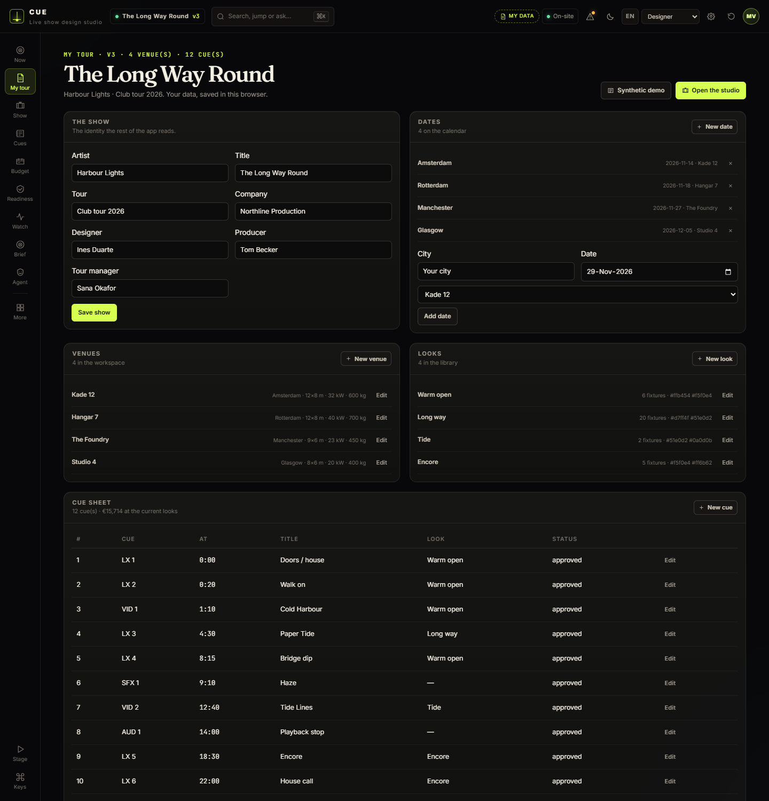
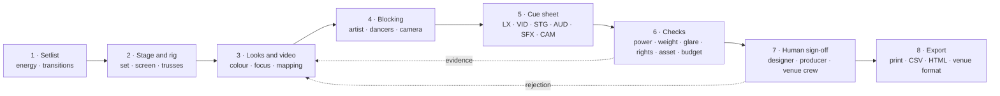
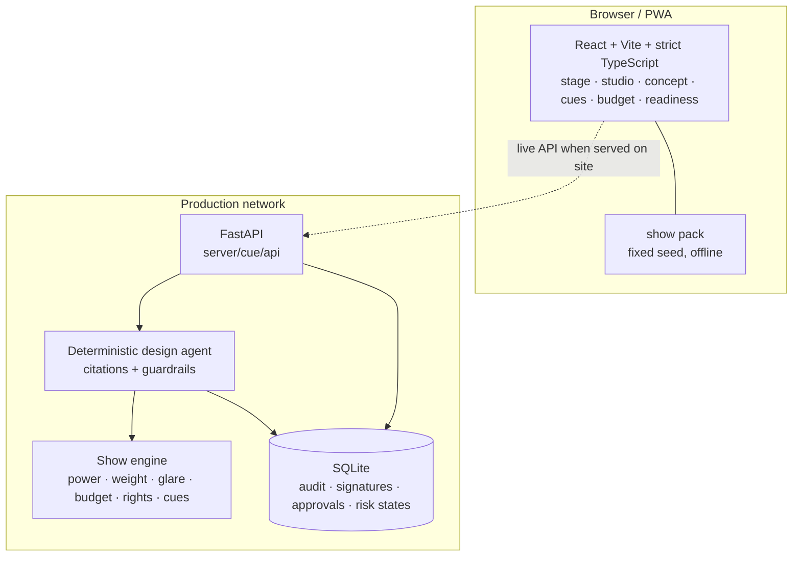

# CUE

**The show is designed before the lights go down.**

[**Play the 90-second show →**](https://jiuwendemos.github.io/cue/#/stage) · [**Open the studio →**](https://jiuwendemos.github.io/cue/#/show) · [**Tour readiness →**](https://jiuwendemos.github.io/cue/#/readiness)

[](https://github.com/jiuwendemos/cue/actions/workflows/ci.yml)
[](https://github.com/jiuwendemos/cue/actions/workflows/pages.yml)



> *It was spectacular. It was wrong. The show is not the rig.*

CUE is the **live show design studio**. It connects the concept, the stage, the looks, the video, the
blocking, the setlist, the cue sheet and the budget on one timeline — and exports into the tools the
crew already uses. The designer authors. CUE proposes and checks.

**This repository is a complete, deterministic public demo.** The show, artist, venues, crew and
audience are synthetic. Every number is calculated from a fixed pack. The track is synthesised in the
browser. Nothing is uploaded, and there is no cloud model call. Read the
[demo guide](https://jiuwendemos.github.io/cue/#/glossary) or the
[provenance sheet](docs/data-provenance.md).

---

## The 3-minute walkthrough

[**▶ Watch: a new tour, built from nothing (2:57, English)**](https://github.com/jiuwendemos/cue/blob/main/demo/cue-walkthrough-en.mp4)

Not a tour of screens. A production office starts from six empty fields and builds
**Harbour Lights — The Long Way Round**:

- the show, the team, a second room and a second date;
- import the Vectorworks fixture schedule and the grandMA3 cue list;
- build the look: 27.3 kW, 440 kg on the front truss;
- the checks name The Foundry, where 23 kW and a 400 kg rating cannot take it;
- the OpenJiuwen agent reads the posted tour and proposes a lower-power option;
- the designer cuts it to seven beams — 19.1 kW, 326 kg — and both rooms pass;
- the real budget lands at €12,744; approve €13,000 and the tour is €256 under;
- sign the safety cues.

[How it was made](demo/walkthrough/README.md) · [the script](demo/walkthrough/script-en.md).

---

## What is here

| Surface | What it is | Try it |
|---|---|---|
| **The 90-second show** | One lamp, one unsafe AI proposal, one human decision, one vote, one printed cue sheet. Deterministic, sound, reset with `R`. | [`/#/stage`](https://jiuwendemos.github.io/cue/#/stage) |
| **The studio** | Stage previz (SVG and on-demand WebGL 3D), looks, video, blocking, timeline, checks and the look rail. Drag a look onto the build. | [`/#/show`](https://jiuwendemos.github.io/cue/#/show) |
| **Concept board** | The mood, references, rules, palette and the setlist as a design board. | [`/#/show?tab=concept`](https://jiuwendemos.github.io/cue/#/show?tab=concept) |
| **Cue sheet** | 26 cues across LX/VID/STG/AUD/SFX/CAM, safety signatures, conflicts, missing assets, print and CSV/HTML/JSON. | [`/#/cues`](https://jiuwendemos.github.io/cue/#/cues) |
| **Rig and budget** | Cost per look, power, truss load, contingency and the over/under against the approved budget. | [`/#/budget`](https://jiuwendemos.github.io/cue/#/budget) |
| **Tour readiness** | Risk board, lifecycle, evidence, show-week brief, digests, coverage, precision and a kill switch. | [`/#/readiness`](https://jiuwendemos.github.io/cue/#/readiness) |
| **Show watch** | Scheduler, watchers, scan history, backtest, delivery, inbox and kill switch. Real on-site; deterministic local stand-in on the public build. | [`/#/watch`](https://jiuwendemos.github.io/cue/#/watch) |
| **Design agent** | Ranked proposals with citations, an inspectable tool trace, guardrails and a human reject/re-rank. | [`/#/agent`](https://jiuwendemos.github.io/cue/#/agent) |
| **Venues** | Seven rooms with stage, rig, power, sightlines, freshness and a fit check against the design. | [`/#/venues`](https://jiuwendemos.github.io/cue/#/venues) |
| **Versions** | Version history, diffs, approvals, signatures and an immutable audit. | [`/#/versions`](https://jiuwendemos.github.io/cue/#/versions) |
| **Pilot** | A 90-day, one-tour pilot dashboard with baselines, gates, kill criteria and honest measurement. | [`/#/pilot`](https://jiuwendemos.github.io/cue/#/pilot) |
| **Mobile review** | The producer and crew phone surface: acknowledge, sign, approve, brief. 44 px targets. | [`/#/mobile`](https://jiuwendemos.github.io/cue/#/mobile) |
| **Studio settings** | Theme, role, language, density, reduced motion and **hide synthetic-demo notices**. | [`/#/settings`](https://jiuwendemos.github.io/cue/#/settings) |
| **Glossary** | How to read a cue sheet, a look, a risk and this demo. | [`/#/glossary`](https://jiuwendemos.github.io/cue/#/glossary) |
| **Provenance** | Rights register, model card, AI disclosure, privacy review and the data-rights annex. | [`/#/provenance`](https://jiuwendemos.github.io/cue/#/provenance) |

The public site is a **static, offline build** of the same product UI. The API and the pilot workflow
live in [`server/`](server/) and serve the same pack, with SQLite for the human decisions.

### Connected surfaces

The on-site service now ships:

- a **durable-shaped scheduler** (`CUE_SCHEDULER=1`) with 7 watcher classes, scan history, dedupe, quiet hours, digest and a kill switch;
- **delivery adapters** for in-app, email, Slack, Teams, SMS and signed webhooks; missing credentials are reported as `simulated`, never silent;
- **real export files**: iCalendar, grandMA3 CSV/XML, Resolume CSV, Vectorworks fixture CSV and a minimal MVR exchange ZIP;
- a **signed share link** for the cue sheet with expiry;
- an **MCP-compatible JSON-RPC server** at `POST /mcp` with read-only show, checks, budget, readiness, cue-sheet and ask tools;
- a **real OpenJiuwen runtime**: a DeepAgent over an OpenAI-compatible model, with eight typed,
  read-only show tools and citations taken only from the tools the model actually called;
- an **optional remote agent adapter** for a service that is not a local runtime, with an explicit 502
  when a configured backend is unavailable.

The public demo still answers locally and makes no external call. Configure the environment to point
any of these at a real service. See [production wiring](docs/production-wiring.md) and
[the integration status table](docs/integrations.md) — every service, why it is needed, and whether it
is verified, built-but-unconfigured, file-exchange or not built.

### The OpenJiuwen agent



The on-site service answers with the same stack CoachMe runs: `openjiuwen`'s `Model` over an
OpenAI-compatible endpoint, a `DeepAgent` built with CUE's tools, and the global `Runner`.

```bash
# Point at any dotenv file. A CoachMe .env (API_BASE / API_KEY / MODEL_NAME) is mapped
# onto CUE_LLM_* automatically. Copy .env.example to .env for the local path.
export CUE_ENV_FILE=../coachme/.env      # PowerShell: $env:CUE_ENV_FILE="..\coachme\.env"

# Run the service with an interpreter that has openjiuwen installed.
cd server
PYTHONPATH=. python -m uvicorn cue.api.app:app --port 8000
```

What the model can read: `show_summary`, `look_checks`, `look_budget`, `open_risks`, `cue_sheet`,
`find_venue`, `rights_windows`, `next_show`. Every tool is read-only. The answer carries the real tool
steps, the citations from those calls and the timings. If the runtime is configured but unreachable the
API returns **502** (`CUE_AGENT_FALLBACK=1` opts into a clearly labelled local answer instead). The
runtime is warmed in the background at boot, so the first question is not a 90-second wait.

Verified against `openjiuwen 0.1.19` and a live `deepseek-v4-pro` endpoint: a cited answer in ~8 s
after warm-up, with 1-3 tool reads.

### Show watch



The on-site build runs the scheduler (`CUE_SCHEDULER=1`), the watchers, the scan history, the delivery
adapters, the signed inbox and the backtest. The public build shows the same surface with a deterministic
local scan and clearly labels it. Nothing is sent anywhere from the static demo.

The *when to interrupt* decision is not CUE's any more. It is made by
[LAIX](https://github.com/michaelatamuk/laix), a pinned dependency, through the small
adapter in [`server/laix_integration/`](server/laix_integration/). CUE keeps detection,
the show store, the cue sheet, notification copy, delivery and outcome labels. See
[the integration note](docs/laix-integration.md).

### 3D previz



The studio keeps the fast SVG previz as the default and loads a WebGL stage on demand. The 3D chunk is
not in the first load; the main bundle is about 176 kB gzip. If WebGL is unavailable, the SVG previz
stays. The 90-second cut has the same physical model behind a `2D / 3D` toggle.

### The manager demo

**One buyer: the independent touring production company.** The daily user is the production office.
CUE is where a tour is designed, priced, checked and signed before load-in — not a console and not a
render farm.



The 10-minute cut lives at [`/#/manager`](https://jiuwendemos.github.io/cue/#/manager). It walks
stage → studio → cue sheet → budget → readiness → pilot proof, and carries four things in one place:

- **the proof table** — iterations avoided, rig cost avoided, rehearsal time, approvals on time — with
  a method and a counter-claim on every row;
- **the demo funnel** — local-only events for start, first touch, reject, vote, finish and print;
- **a venue check** that tests WebGL, audio, the offline shell, fonts, storage, the connection and a
  reset under five seconds, in the room;
- **the printed consequence** — in the 90-second cut the room's vote changes the drop row, the show
  cost and the approved delta, and `Print this sheet` prints exactly that.



Full script: [manager demo](docs/manager-demo.md). Room runbook: [venue test](docs/venue-test.md).
Fallback for a failed projector or GPU: `/#/stage?fallback=1` (silent SVG path). Kiosk mode:
`/#/stage?autoplay=1&loop=1`.

### Your own tour, or the demo



CUE opens on the synthetic show, but it is not the only source. **My tour** creates a blank workspace
with real authoring:

- edit the show, dates, **venues**, **looks**, **cues** and **budget**;
- import a **show pack** (JSON), a **grandMA3 cue list** (CSV) or a **Vectorworks fixture schedule**
  (CSV) — parsed in the browser, never uploaded;
- export the whole tour as JSON;
- switch between **the synthetic demo** and **your tour** in **Settings → Data source**. Neither is
  deleted by switching.



A worked case ships with the repo: **Harbour Lights — *The Long Way Round***. Four rooms, 12 cues, 20
fixtures, a €15,000 budget and four open risks you can analyse. Load it from My tour, or open
[`/#/?example=1`](https://jiuwendemos.github.io/cue/#/?example=1).

- [The worked example, and what to fill in](examples/harbour-lights/README.md)
- [How your data is stored, imported and what it cannot do yet](docs/own-data.md)

---

## The trust beat

The agent ranks **AERIAL 12** first: twelve beams, impact 97, spectacular in previz. It is also:

- **44 kg over the front truss rating** — 564 kg on a 520 kg truss;
- **1.6 kW over the house supply** — 44.1 kW against 43.5 kW;
- **blinding the front row** — glare 0.92 against a 0.55 limit, six beams below the 1.15 m eyeline.

The designer rejects it. The reason is stored. The ranking is recomputed. **SIX BEAM + MONOLITH** —
impact 89, 34.5 kW, 312 kg, no audience-aimed fixture, €1,373 under budget — is the show.

That is the product in one minute: creativity, evidence, a human decision, and a system that updates.

---

## How it works



The math is deliberately simple and auditable. Every check shows the metric, the limit and the
source record. No number is a black box.

---

## What is real, and what is simulated

| Real in this demo | Simulated |
|---|---|
| Power, weight, glare, budget, rights and cue math | The artist, songs, venues, rig, set, video and audience |
| The reactive ranking and the human reject/re-rank | The look suggestions and their confidence |
| The cue sheet, safety signatures, versions and audit | The pilot numbers and the production company |
| The readiness lifecycle, evidence and show-week brief | The GPU/NPU timings and live integrations |
| The static offline pack and the reset | The music: synthesised, not a commercial recording |

**You can hide the synthetic-show notices** in **Studio settings → Interface**. The data stays
synthetic; the notices go quiet. The provenance page always keeps the facts.

---

## Quick start

### Public demo (no install)

Open <https://jiuwendemos.github.io/cue/>. It runs fully offline after the first load. Press `R` on the
stage piece to reset.

### Web locally

```bash
cd web
npm install
npm run dev        # http://127.0.0.1:5174
npm run build      # typecheck + production build
```

### API locally

```bash
# generate the shared pack from the TypeScript source
cd web && npm run pack

# the on-site API
cd ../server
python -m pip install -e ".[dev]"
uvicorn cue.api.app:app --reload --port 8000
```

The dev server proxies `/api` to `127.0.0.1:8000`. The API also serves `web/dist` when it exists.

### Tests

```powershell
$PY = "C:\Workspace\openjiuwen\jiuwenswarm\.venv\Scripts\python.exe"
& $PY -m pip install -e "server[dev]"
& $PY -m pytest -q server
& $PY -m ruff check server
```

### One on-site service

```bash
docker compose up --build
# open http://127.0.0.1:8000
```

The SPA is served by FastAPI; the SQLite store lives in the `cue-data` volume. No outbound network is
required after setup. See [deployment](docs/deployment.md).

---

## Architecture



**Repository layout**

```
cue/
  web/
    src/
      data/        the single demo pack + moodboard
      lib/         engine · store · agent answers · audio · i18n · UI context
      components/  stage canvas · timeline · shell · demo guide · settings · UI
      pages/       stage · studio · concept · cues · budget · readiness · agent · venues ·
                   versions · pilot · mobile · design system · admin · provenance · settings ·
                   glossary · about
      styles.css   tokens, themes, print, responsive, reduced motion
    public/        favicon, manifest, offline shell assets
    scripts/       export the single pack to JSON for the server
  server/cue/
    api/           FastAPI routes
    engine/        deterministic show math
    agent/         deterministic agent + DeepAgent seam
    store/         SQLite audit, signatures, approvals, risk lifecycle
    data/          generated show.json (shared with web)
    tests/         engine math and API flows
  docs/            roadmap · architecture · stage script · pilot · data rights · deployment · 2026
  deploy/          systemd unit and environment template
  scripts/         developer helpers
```

---

## Roadmap

The full, item-by-item status is in [docs/roadmap.md](docs/roadmap.md). The short version:

- **0A — the stage piece:** built. Deterministic 90 seconds, sound, trust beat, vote, cue-sheet reveal, reset under five seconds.
- **0B — the functional demo:** built. Editable show, looks, video, blocking, cue sheet, budget, checks, offline.
- **1 — the pilot surface:** built as software. One production company, three shows and 90 days still need a real customer.
- **4 — tour readiness:** built. Risk board, lifecycle, show-week brief, dedupe, coverage, precision, kill switch.
- **5 — interface 2026:** built. Three themes, tokens, command palette, role navigation, mobile review, EN/中文, provenance, accessibility.
- **6 - production wiring:** the OpenJiuwen agent, render/inference, integrations, store and security are wired. The end-to-end gate needs a real tour.
- **2–3 — production and scale:** adapters and UI surfaces exist; live vendor integrations and a multi-city network are pilot work.

**The next three tracks** — [make it proactive, make it true 2026, make it connected](docs/roadmap-next.md) — are
a detailed plan with 522 checkboxes, gates and a 30/60/90-day sequence. They are the honest gap between this
demo and a production system.

---

## Non-goals

- **No live show control.** No DMX, no console, no automatic cue release.
- **No renderer replacement.** Depence², WYSIWYG, Capture and Vectorworks remain the previz and drafting tools.
- **No music generation.** The artist's track is the source of truth.
- **No CAD replacement.** CUE is the design layer above the drafting.
- **No autonomous design.** The designer authors; the AI proposes and checks.
- **No hardware.** No fixture, console or rig is required to use CUE.

---

## Data rights

- Public demo data is **synthetic**, generated in-house with a fixed seed. Licence: MIT.
- No commercial recording, artist likeness or venue data is used.
- The track is synthesised in the browser from the energy curve.
- Artist content stays local by default; any upload needs written permission and is recorded in the rights register.
- Venue and rig data are customer confidential. Cross-tenant sharing is off by default.
- AI proposals are labelled, attributable and designer-owned on approval.

Read the [provenance sheet](docs/data-provenance.md) and the [data-rights annex](docs/data-rights.md).

---

## Licence

MIT. See [LICENSE](LICENSE).

Built as a demonstration of evidence-first live-show design. The designer owns the decision; CUE never
runs the show.
