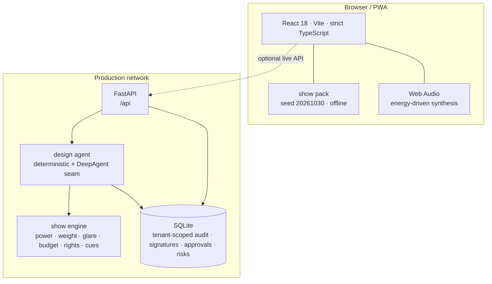

# Architecture

CUE is a static design studio plus a small on-site service. The public demo does not need the service;
the service is the pilot path for the human decisions, the audit and the real integrations.

## The single pack

`web/src/data/pack.ts` is the only source of the synthetic show. It is a typed object: project, concept,
setlist, stage, rig, looks, video, blocking, cues, budget, rights, venues, dates, risks, versions,
suggestions, agent trace, audit, notifications, metrics, integrations, users, billing and provenance.

`web/scripts/export_pack.mjs` bundles that module with esbuild and writes
`server/cue/data/show.json`. The web app imports the TypeScript directly; the Python engine reads the
JSON. Both use the same identifiers and the same math. CI fails if the committed JSON drifts from the
TypeScript source.

## The show engine

The engine is deliberately small and auditable:

- **Power**: fixtures in the look + 13.5 kW of always-on screen, audio and haze, against the venue
  supply. A look over 100% fails; over 90% warns.
- **Weight**: per-truss fixture weight plus 60 kg of cable on each loaded truss, against the truss
  rating. A look over 100% fails.
- **Glare**: `audienceAim / 8 + energy × 0.18`, capped at 1, against a 0.55 limit. The audience is
  never the target.
- **Budget**: base lines + contingency on the base subtotal + optional look/video add-ons. Optional
  lines are priced only when the look is active.
- **Cue math**: same-family cues within 0.5 s collide; a cue whose look was rejected resolves to the
  approved landing look, while the original stays visible in the editor.
- **Rights**: each asset has a territory, a window and a source. A show after the window fails.
- **Schedule**: cues per load-in hour, benchmarked at 4.5.
- **Data freshness**: months since the venue profile was verified, against a 12-month contract.

The TypeScript and Python implementations are covered by tests (`server/tests/test_engine.py`). The
numbers are simple enough to check by hand, which is the point.

## The state machine

The client persists human decisions in `localStorage` under `cue.demo.v1`: rejected looks, accepted
looks, the vote, cue edits, signatures, risk states, owners, checks, dismissal reasons, version
approvals, notification reads, settings and local audit events. Reset is a single state drop.

The server persists the same decisions in SQLite, scoped to a tenant. The web app probes `/api/health`
when it is not on GitHub Pages and hydrates the audit/readiness surfaces if the service is present.

## Why the SPA is static

- The booth must run with the network cable unplugged.
- The show must be deterministic and identical on every run.
- The studio is a design instrument; a render farm is a separate concern.
- GitHub Pages hosts the public demo at zero cost, with a service worker for the second load.

The static build is 548 kB raw / 161 kB gzip for the entry bundle, plus local fonts. There is no CDN,
no analytics and no external call after load.

## API

| Method | Path | Purpose |
|---|---|---|
| GET | `/api/health` | show, agent, storage, tenant, render |
| GET | `/api/agent/status` | configured / available / backend / model |
| GET | `/api/agent/tools` | tools, guardrails, trace |
| POST | `/api/agent/ask` | cited answer; never mutates |
| GET | `/api/show` | project, concept, setlist, stage, rig, counts |
| GET | `/api/checks` | power, weight, glare, rights, asset, budget |
| GET | `/api/budget` | lines, add-ons, total, approved |
| GET | `/api/cues` | cue rows, conflicts, missing, signatures |
| POST | `/api/cues/{id}/sign` | human safety signature |
| GET | `/api/readiness` | risks, stats, brief, coverage, metrics |
| POST | `/api/readiness/{id}/{action}` | ack, assign, investigate, resolve, verify, reopen, dismiss |
| POST | `/api/readiness/{id}/checks/{check}` | complete a suggested check |
| GET | `/api/proactive` | scheduler, watchers, scans, inbox, delivery, digest, backtest |
| POST | `/api/proactive/scan` | run the scanner now |
| POST | `/api/proactive/settings` | mode, interval, channels, quiet hours |
| POST | `/api/proactive/stop` / `start` | kill switch |
| POST | `/api/proactive/digest` | build / send a digest |
| GET | `/api/proactive/backtest` | synthetic pre-load-in backtest |
| GET | `/api/notifications` | tenant inbox |
| POST | `/api/share` | signed link with expiry |
| GET | `/api/share/cue-sheet` | verify a signed link and print |
| GET | `/api/export/ics` | iCalendar tour export |
| GET | `/api/export/grandma3.csv` / `.xml` | console cue export |
| GET | `/api/export/resolume.csv` | video clip list |
| GET | `/api/export/vectorworks.csv` | fixture schedule |
| GET | `/api/export/mvr.zip` | minimal MVR exchange package |
| GET/POST | `/mcp` | MCP-compatible JSON-RPC read-only tools |
| GET | `/api/versions` | versions + approvals |
| POST | `/api/versions/{id}/approve` | human approval signature |
| GET | `/api/audits` | append-only trail |
| GET | `/api/integrations` | adapters, live/simulated, strict readiness |
| GET | `/api/render/status` | device, quality, explicit missing-NPU error |
| GET | `/api/provenance` | rights, model card, guardrails |
| GET | `/api/tenants` | tenant header and isolation note |
| GET | `/api/ready` | strict production gate |

## Deliberate non-goals

No DMX, no live console control, no automatic cue release, no music generation, no full CAD, no
renderer replacement, no autonomous show design, no hardware. The designer is the author; the crew runs
the show.
